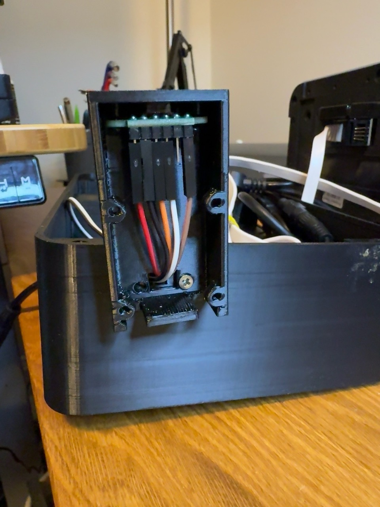
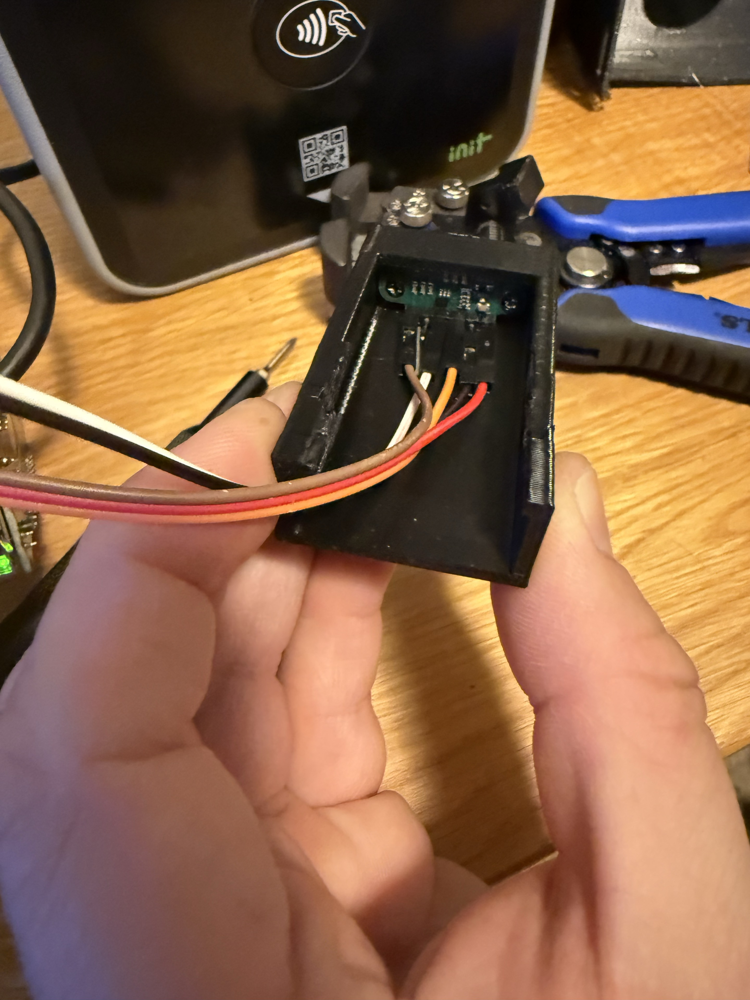

# Actual prototype photos

These are real build photos supplied by whim.ski, not renders. They show earlier bottom-mounted ToF cradle experiments, **not the current v18 side-sponson geometry**. EXIF/location metadata was removed from publication copies without changing image pixels. The originals remain private and unchanged.

