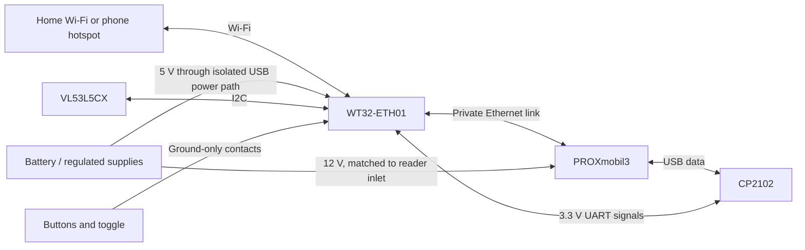

# WT32-ETH01 wiring used by the prototype

This table is specific to the photographed WT32-ETH01 v1.4. GPIO numbers are not header positions. Compare the board silkscreen and [manufacturer pinout](https://wiki.wireless-tag.com/docs/en/WT32-ETH01/board_features.html). GPIO signals are 3.3 V.

| Connection | WT32-ETH01 |
|---|---|
| CP2102 TXD | RX0 / GPIO3 |
| CP2102 RXD | TX0 / GPIO1 |
| CP2102 GND | GND |
| Regulated 5 V power | 5V; common GND |
| ToF SDA | GPIO33, header **485_EN** |
| ToF SCL | GPIO32, header **CFG** |
| ToF VIN | 3V3 for the selected breakout |
| ToF GND | GND |
| Action tact switch | GPIO14 to GND |
| Mode tact switch | GPIO4 to GND |
| Toggle throw A | GPIO15 to GND through common |
| Toggle throw B | GPIO2 to GND through common |
| Toggle common | GND |

The two tact switches and toggle use internal pull-ups; switch contacts pull down to GND. The historical protocol names for the toggle are `trk5` (GPIO15) and `trk1` (GPIO2); software may interpret them as generic directions. Confirm lever-to-contact orientation by continuity. GPIO2 and GPIO15 are boot-strapping pins: keep the switch ground-only. GPIO36 and GPIO39 have no internal pull-ups and are not the chosen connections.

ToF INT is unused by the polling configuration. The module's LPn must be high for operation; inspect the exact board's pull-up or wiring rather than assuming every clone is identical. The selected board has operated in this build. Match the labels on the sensor rather than inferring pin order from its back side.

For serial flashing, hold IO0 to GND during reset/power-up, then remove that connection for normal boot. The generic CP2102 wiring does not promise automatic reset/boot control. Connect only one intended 5 V source; the current battery injector arrangement needs correct host-VBUS isolation while retaining USB data. Do not blindly parallel the PC/PM3 USB supply and battery USB supply.

The WT32 Ethernet port connects to the PM3 Ethernet port for the accessory's private wired link. Wi-Fi supplies the upstream network. Its USB-UART path carries controls and recovery traffic. This separation is why working PM3 NFC does not establish that the WT32 radio or inputs are healthy.

## Connections at a glance

The power arrow describes the prototype's separate-power arrangement. It is not a schematic for an arbitrary USB injector cable. Verify its isolation and do not tie two independent 5 V sources together.
